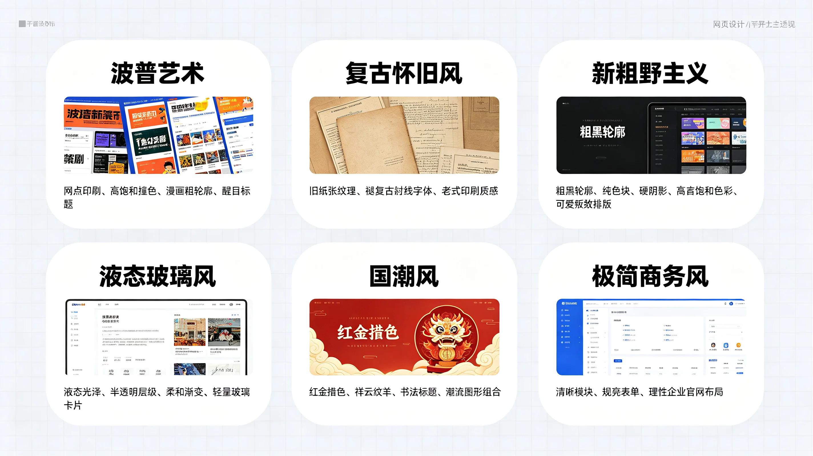
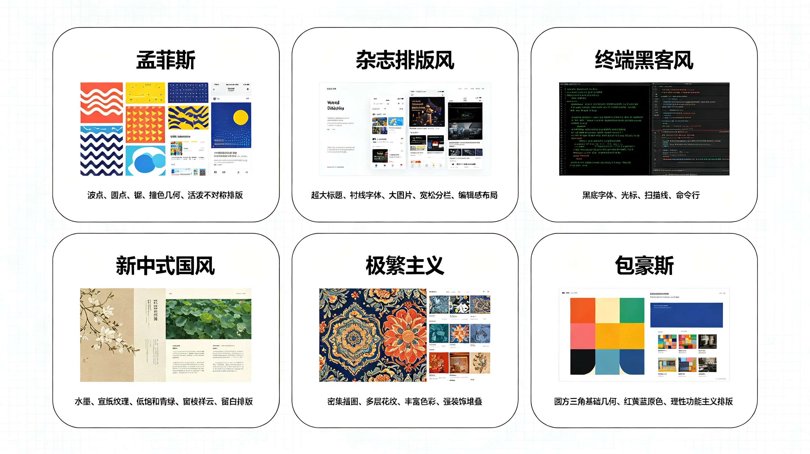

# 茗述

马上就要期中考试了，就在这周的周天下午，以及下一周就要测量学实习去了，心里还是没有多少的地，这个高数真的太难了，我感觉我上课认真听了还是不太行，就是需要多多的刷题才行，见得题型多了差不多就会做了，专门买了宋浩的练习题。得了，我发现写一道看一道题答案，我貌似有点太废了，对高数的探索不足百分之10。以及下周要去稻香村实习，作为队长的我，希望能够履行好这次的义务，希望我能办好这件事情把，带领好我的组员一起完成任务，上一次实习在学校都是倒数第一名，真的没招了，对仪器太不熟悉了，唉！

希望一切安好！让我数学及格吧！让我们实习顺利吧！ --祈祷一下

# 茗叙

## 前言

如果你也想做出好看的`网页设计`，看惯了AI设计的丑陋，那么你可以看看这篇文章。说不定对你有用，搭配`不同的Skills`，相同的提示词也会有`不同的效果`。

最近我在报名**职业规划大赛**，但是我初次使用ＡＩ给我制作ＰＰＴ，我寻思着ＡＩ应该高级点，但谁直到做出来的第一版ＰＰＴ。我去！太丑了，丑的不能再丑了，之后尝试了别人的提示词，还是很丑很丑，要么就是没有动画，要么就是文字乱飞，那么这到底是什么问题呢？首先就是`ＰＰＴ的模板`，找到一个心仪的模板才能做出好看的ＰＰＴ，之后在使用`ＡＩ添加特效`，`修改文字`等等，或者使用下面的Ｓｋｉｌｌｓ，做出属于你的ＰＰＴ以及网页的设计

设计的风格大概分为这几类：

## 先说清楚：Skill 到底是个啥

很多人以为 Skill 是「插件」，装完 AI 就变聪明了——其实不是。

**Skill 本质上是给 AI 装的一套「说明书 + 工作流 + 审美标准」。** 模型本身很聪明，但它不知道你嘴里的「高级感」长什么样，也不知道做 PPT 该先定版式还是先填字。Skill 把这些经验固化下来：用什么字体、留白留多少、配色怎么搭、分几步走、哪一步该停下来给你看图。

所以你会发现一个现象：**同一个提示词，换个 Skill，做出来的东西完全是两个样。** 这不是模型抽卡，是你没给它「判断标准」。

用起来一般两种方式：装进你的 Agent（Claude Code、Codex、DSH 这类都行），或者直接把仓库里的 `SKILL.md` 丢给 AI 当上下文。

下面按用途分了六类，每一类我都写了「它到底能干什么」，方便你直接按需求挑。

## 网页设计 Skills

这一类现在最卷，头部那几个基本是把「设计系统」整个搬给 AI 了：配色、字体、间距、交互、动效规则全都写死在 Skill 里。适合做落地页、个人主页、产品官网这种「第一眼就要好看」的页面。

| Skill                                                                                                                | Star  | 它能做什么                                                           |
| -------------------------------------------------------------------------------------------------------------------- | ----- | --------------------------------------------------------------- |
| [ui-ux-pro-max-skill](https://github.com/nextlevelbuilder/ui-ux-pro-max-skill)                                       | 90.4k | 当前设计类绝对头部：UI/UX 设计知识库，涵盖配色、字体、布局、交互、动效和多技术栈规则。                  |
| [taste-skill](https://github.com/Leonxlnx/taste-skill)                                                               | 41.4k | 专门提升 AI 的视觉品味和前端审美判断，减少模板化 AI UI。                               |
| [huashu-design](https://github.com/alchaincyf/huashu-design)                                                         | 24.2k | 设计哲学 + 高保真 UI + 动效 + 视觉 QA 的完整设计 Skill。                         |
| [MengTo Skills](https://github.com/MengTo/Skills)                                                                    | 6.1k  | 面向设计师和 Builder 的 Agent Skills，强调视觉参考、设计判断与高质量前端实现。              |
| [scroll-world](https://github.com/skills-directory/scroll-world)                                                     | 4.6k  | 高端 3D scroll-scrub Landing Page 与连续镜头式网页体验。                     |
| [emilkowalski/skills](https://github.com/emilkowalski/skills)                                                        | 2.6k  | 聚焦前端设计、动画、交互细节和产品界面质感。                                          |
| [make-interfaces-feel-better](https://github.com/skills-directory/make-interfaces-feel-better)                       | 2k    | 专门打磨交互手感、布局细节与界面完成度。                                            |
| [designer-skills](https://github.com/skills-directory/designer-skills)                                               | 1.6k  | 设计 Agent Skills：视觉方向、UI 判断和产品设计输出。                              |
| [awesome-design-skills](https://github.com/skills-directory/awesome-design-skills)                                   | 1.3k  | 设计 Skills 索引，覆盖 Codex、Cursor、Claude Design 等 Agentic Design 工具。 |
| [UI Skills — Dawit Labs](https://github.com/dawitlabs/ui-skills)                                                     | <1k   | 把可访问性、色彩、响应式设计和截图检查等 UI/UX 流程做成可复用 Skills。                      |
| [Design OS](https://github.com/buildermethods/design-os)                                                             | <1k   | 先确定视觉方向，再统一字体、色彩、组件、动效和页面语言。                                    |
| [Anthropic Frontend Design](https://github.com/anthropics/claude-plugins-official/tree/main/plugins/frontend-design) | 官方总仓库 | 官方 Frontend Design Skill，主动确定字体、配色、版式与视觉方向，减少模板化 AI 感。          |

我的建议：**只装一个就够了**。想稳妥选官方的 `frontend-design`，想要更花哨选 `ui-ux-pro-max-skill`，嫌 AI 味重就再叠一个 `taste-skill`。

## PPT Skills

做 PPT 的痛点是「能改」和「好看」经常二选一：原生 PPTX 能改但丑，HTML 演示好看但导出麻烦。这一类的区别就在于路线不同，挑之前先想清楚你要的是「交上去能改」还是「投屏能炸场」。

| Skill                                                                    | Star  | 它能做什么                                                                  |
| ------------------------------------------------------------------------ | ----- | ---------------------------------------------------------------------- |
| [PPT Master](https://github.com/hugohe3/ppt-master)                      | 55.0k | 原生 PPTX 路线，直接生成真正可编辑的 PowerPoint，支持原生形状、图表、模板、转场与动画。                   |
| [frontend-slides](https://github.com/zarazhangrui/frontend-slides)       | 29.4k | 动画丰富的 HTML 演示文稿 Skill，偏高审美、网页原生和强视觉表达。                                 |
| [guizang-ppt-skill](https://github.com/op7418/guizang-ppt-skill)         | 26.5k | 电子杂志 × 瑞士国际主义视觉系统，适合中文叙事、观点和分析型 Deck。                                  |
| [huashu-design](https://github.com/alchaincyf/huashu-design)             | 24.2k | 更宽泛的设计 Skill，但包含高质量 Slides、动效、视觉评审与 MP4 输出。                            |
| [Banana Slides](https://github.com/Anionex/banana-slides)                | 15k+  | 一站式 AI PPT 生成，从一句话、大纲或模板生成，并支持导出可编辑 PPTX。                              |
| [dashi-ppt-skill](https://github.com/chuspeeism/dashi-ppt-skill)         | 8.4k  | 浏览器可编辑演示文稿，多主题生成，并可导出 HTML、PDF、PPTX。                                   |
| [html-ppt-skill](https://github.com/lewislulu/html-ppt-skill)            | 5.9k  | HTML PPT Studio：24 个主题、31 种布局、20+ 动效。                                  |
| [codex-ppt-skill](https://github.com/harish-garg/codex-ppt-skill)        | 2.1k  | 面向 Codex 的 HTML presentation deck / slide-style visual document Skill。 |
| [ppt-image-first](https://github.com/liyupi/ppt-image-first)             | 1.2k  | Image-first PPT 工作流，强调先做视觉资产再组装演示文稿。                                   |
| [PPT-Design-Skill](https://github.com/skills-directory/PPT-Design-Skill) | 1.2k  | 强调海量风格、布局控制、AI 图片生成和可编辑 PPTX 输出。                                       |

经验：**先定模板，再让 AI 填内容**。反过来做，AI 会把你的内容硬塞进它默认的「商务蓝」模板里，怎么调都土。

> 我这里有一套我总结的模板：
> 
> [网盘分享](https://pan.quark.cn/s/69f7ebd49fb4)

## 文章 / 论文 / 深度研究 Skills

这一类解决的不是「写得好看」，而是「写得像人写的」和「查得够深」。前者靠 `humanizer` / `stop-slop` 去 AI 味，后者靠 deep research 系列把一个大问题拆成多轮检索和交叉验证。

| Skill                                                                                                   | Star  | 它能做什么                                                  |
| ------------------------------------------------------------------------------------------------------- | ----- | ------------------------------------------------------ |
| [last30days-skill](https://github.com/mvanhorn/last30days-skill)                                        | 39.6k | 从 Reddit、X 等近期讨论做研究，再把真实讨论综合成可用结论和 Prompt。             |
| [academic-research-skills](https://github.com/ai-research-skills/academic-research-skills)              | 30.2k | 完整学术研究链：research → write → review → revise → finalize。 |
| [claude-scientific-skills](https://github.com/K-Dense-AI/claude-scientific-skills)                      | 28k   | 面向科研、分析和科学写作的大型 Claude Skills 集合。                      |
| [scientific-agent-skills](https://github.com/K-Dense-AI/claude-scientific-skills)                       | 28k   | 研究、科学、工程、分析、金融和写作的一体化 Agent Skills。                    |
| [humanizer](https://github.com/blader/humanizer)                                                        | 23.7k | 把 AI 味明显的文字改得更自然，适合文章和报告最后一轮润色。                        |
| [Auto-claude-code-research-in-sleep](https://github.com/Anil-matcha/Auto-claude-code-research-in-sleep) | 11.9k | 轻量 Markdown-only 的自动研究工作流，适合持续迭代式研究。                   |
| [stop-slop](https://github.com/hardikpandya/stop-slop)                                                  | 10k   | 专门清除 AI 写作痕迹和套路化表达。                                    |
| [AI-research-SKILLs](https://github.com/Orchestra-Research/AI-research-SKILLs)                          | 9.6k  | 面向 AI 研究与工程的开源 Skills 库，适合技术研报和研究工作流。                  |
| [Research Writing Skill](https://github.com/Norman-bury/research-writing-skill)                         | 3.2k  | 偏正式科研与长文写作，覆盖选题、文献综述、证据驱动写作、图表和 LaTeX 成稿。              |
| [Deep Research Skills — Weizhena](https://github.com/Weizhena/Deep-Research-skills)                     | 876   | 先生成研究大纲，再逐项深挖并汇总成结构化报告，适合市场、技术与学术调研。                   |
| [Deep Research — PsChina](https://github.com/PsChina/deep-research)                                     | <1k   | 多步深度研究：研究计划、多源验证、反方证据、交叉核实，最后输出顾问级报告。                  |
| [Deep Research — hint-shu](https://github.com/hint-shu/deep-research)                                   | <1k   | 把研究分成 L0–L5 六档，从快速事实核查到长时深度研究，可按任务控制研究强度。              |

## 绘画 / 设计 / 视觉创作 Skills

严格说这一类是把「设计」和「出图」打通了：既能出海报、Logo、IP 形象，也能出 Sprite、GIF、单色插画。做小红书封面、公众号头图、品牌视觉的可以重点看这一段。

| Skill                                                                                                                  | Star  | 它能做什么                                                   |
| ---------------------------------------------------------------------------------------------------------------------- | ----- | ------------------------------------------------------- |
| [ui-ux-pro-max-skill](https://github.com/nextlevelbuilder/ui-ux-pro-max-skill)                                         | 90.4k | 超大设计知识库：84 种风格、192 套配色、74 组字体、UX 规则和多端设计系统。             |
| [taste-skill](https://github.com/Leonxlnx/taste-skill)                                                                 | 41.4k | 训练 AI 的「视觉品味」，重点改善字体、层级、留白、配色与前端视觉判断。                   |
| [huashu-design](https://github.com/alchaincyf/huashu-design)                                                           | 24.2k | 从视觉哲学到高保真页面、Slides、动效和视觉评审的综合设计 Skill。                  |
| [frontend-slides](https://github.com/zarazhangrui/frontend-slides)                                                     | 29.4k | 虽然是 Slides，但本质是强视觉编辑设计系统，适合版式、字体和视觉叙事。                  |
| [guizang-ppt-skill](https://github.com/op7418/guizang-ppt-skill)                                                       | 26.5k | 杂志设计与瑞士国际主义方向非常强，可视为平面 / 编辑设计型 Skill。                   |
| [fireworks-tech-graph](https://github.com/skills-directory/fireworks-tech-graph)                                       | 7.6k  | 生成生产级 SVG/PNG 技术图形，属于信息设计与视觉表达。                         |
| [scroll-world](https://github.com/skills-directory/scroll-world)                                                       | 4.6k  | 3D 场景、镜头运动和沉浸式网页艺术方向。                                   |
| [ip-as-logo-skill](https://github.com/skills-directory/ip-as-logo-skill)                                               | 3.8k  | IP、Logo、角色视觉和品牌图形设计；用受约束的形状、配色和构图生成圆润 IP / Mascot Logo。 |
| [Generative-Media-Skills](https://github.com/skills-directory/Generative-Media-Skills)                                 | 3.5k  | 多模态生成媒体 Skills，覆盖图像、视频、音频，是视觉创作的大型工具包。                  |
| [agent-sprite-forge](https://github.com/skills-directory/agent-sprite-forge)                                           | 2.6k  | 从 Prompt 生成 2D Sprite Sheet、透明 PNG 帧和 GIF 动画。           |
| [mono-color-skill](https://github.com/skills-directory/mono-color-skill)                                               | 2.1k  | 单色墨水式编辑视觉：海报、Zine、肖像、包装和视觉笔记。                           |
| [nano-banana-pro-prompts-recommend-skill](https://github.com/skills-directory/nano-banana-pro-prompts-recommend-skill) | 1.6k  | 从 6000+ Nano Banana Pro 图像 Prompt 中推荐合适视觉方案。            |

## 剪辑 / 视频制作 Skills

视频这块门槛最高，因为 AI 得同时懂「镜头语言」和「时间轴」。榜单里既有全流程的 Agent 系统，也有只干一件事的小工具（切片、字幕、转场），按需组合就行。

| Skill                                                                                         | Star        | 它能做什么                                                                               |
| --------------------------------------------------------------------------------------------- | ----------- | ----------------------------------------------------------------------------------- |
| [OpenMontage](https://github.com/calesthio/OpenMontage)                                       | 59.7k       | 当前这一类真正的头部：Agentic Video Production System，12 条生产 Pipeline、100+ 工具、700+ Skill/知识文件。 |
| [html-video](https://github.com/remotion-dev/html-video)                                      | 4.2k        | HTML/CSS + 数据直接生成真实 MP4，偏程序化视频生产。                                                   |
| [Generative-Media-Skills](https://github.com/skills-directory/Generative-Media-Skills)        | 3.9k（视频榜快照） | 图像/视频/音频多模态 Agent Skills，适合完整媒体生产链。                                                 |
| [ArcReel](https://github.com/arc-reel/ArcReel)                                                | 3.8k        | 从小说/脚本到角色、分镜和视频，强调跨镜头角色一致性。                                                         |
| [FireRed-OpenStoryline](https://github.com/FireRedTeam/FireRed-OpenStoryline)                 | 3.2k        | 意图驱动的 AI 视频编辑 Agent，通过 MCP + Skills 做导演式剪辑。                                         |
| [video-shotcraft](https://github.com/vincentwei1021/video-shotcraft)                          | 2.2k+（当前目录） | 电影感产品视频 Skill：分镜、镜头运动、节奏剪辑、声音设计和 Remotion。                                          |
| [Remotion Agent Skills](https://github.com/remotion-dev/skills)                               | 4.6k        | Remotion 官方 Agent Skills：创建、动画、字幕、渲染、地图和多媒体。                                        |
| [story-to-handdrawn-video](https://github.com/skills-directory/story-to-handdrawn-video)      | 665         | 把中文故事文案或图片序列自动做成手绘日记漫画式动画。                                                          |
| [FFmpeg Skill](https://github.com/kajish05/ffmpeg-skill)                                      | <1k         | 给 AI 一套本地 FFmpeg 工作流，可做切片、拼接、字幕、调速、音频处理和批量剪辑。                                       |
| [Claude Video Editor](https://github.com/watzing/claude-video-editor)                         | <100        | Whisper 转录驱动剪辑，适合口播、录屏和教程视频，自动提出删减点并可在浏览器微调。                                        |
| [OpenClip Agent Skills](https://github.com/OpenClip-App/agent-skills)                         | <100        | 把长视频切成带字幕 Shorts，并提供转录、格式转换、缩略图和背景移除等工具。                                            |
| [Vertical Video Editing Skills](https://github.com/nopefallacy/vertical-video-editing-skills) | 51          | 专门处理 9:16 与多比例短视频，自动做字幕、B-roll、转场和可复用风格预设。                                          |

## 省 Token Skills

这一类不产出内容，但**直接决定你的钱包和上下文长度**。思路分两种：一种让 AI 少说废话（Ponytail、Caveman），一种在内容进模型之前先压一遍（MarkItDown、AgentOne、Agent Token Saver）。

| Skill                                                                          | Star        | 它能做什么                                                                                                                          |
| ------------------------------------------------------------------------------ | ----------- | ------------------------------------------------------------------------------------------------------------------------------ |
| [Ponytail](https://github.com/DietrichGebert/ponytail)                         | 149.5k      | 让 Coding Agent 少写无意义代码、减少过度设计和工程复杂度。                                                                                           |
| [Andrej Karpathy Skills](https://github.com/multica-ai/andrej-karpathy-skills) | 216.1k      | 基于 Karpathy 对 LLM 编程问题的总结，约束 Coding Agent 少犯典型错误。                                                                              |
| [Caveman](https://github.com/JuliusBrussee/caveman)                            | 108.6k      | 省 Token / Proxy，通过极简 Agent 通信压缩上下文和输出。                                                                                         |
| [MarkItDown](https://github.com/microsoft/markitdown)                          | 187.8k      | 微软文档转 Markdown 工具，把 PDF、Word、PPT、Excel 等转换成更适合 AI 阅读的文本。                                                                       |
| Context Compression                                                            | 47.1k（所属仓库） | 专门解决长 Agent 会话的上下文膨胀。把历史对话压缩为保留任务目标、决策、文件修改、风险和下一步的结构化摘要，目标不是单纯「说短一点」，而是减少 tokens per task。                                    |
| Context Optimization                                                           | 18k（所属仓库）   | 除了压缩，还系统处理 context budgeting、tool output masking、KV/prefix cache、retrieval scoping、partitioning，本质是让 Codex/Claude 少加载无关内容。     |
| [AgentOne Token Compression](https://github.com/IterateAI/compression)         | 9           | 真正「动手省 token」的工具型 Skill。会在 JSON、Shell 输出、Grep、日志、代码进入模型上下文前进行压缩；仓库自己的混合 benchmark 报告约 75% reduction，但实际节省取决于输入类型。              |
| [Agent Token Saver](https://github.com/Supersynergy/agent-token-saver)         | 7           | 针对 Codex/Claude Code 的上下文垃圾治理：限制读取范围、压缩工具输出、按需加载 Skill、控制子 Agent 获得的上下文。项目报告的 Codex A/B 测试约减少 19.67% provider-reported tokens。 |

> 说明：`Context Compression` 和 `Context Optimization` 这两项原图只给了仓库名、没给直链，按名字在 GitHub 搜就能找到。

## 怎么挑：我的搭配建议

装一堆 Skill 不是好事，上下文会被占满，AI 反而更迷糊。我的做法是**每类只留 1–2 个**：

- **网页**：`ui-ux-pro-max-skill` 管规则，`taste-skill` 管审美，官方 `frontend-design` 兜底。
- **PPT**：要交上去能改就 `PPT Master`，要现场投屏炸场就 `frontend-slides` 或 `guizang-ppt-skill`。
- **文章**：写完先过一遍 `humanizer`，嫌 AI 味重再加 `stop-slop`。
- **绘画**：封面海报用 `mono-color-skill`，要 IP / Logo 用 `ip-as-logo-skill`。
- **剪辑**：想一条龙用 `OpenMontage`，只想切片配字幕用 `FFmpeg Skill`。
- **省 Token**：文档先 `MarkItDown` 转一遍，再把 `Caveman` 挂上，立竿见影。

## 写在最后

写这篇的时候我自己的感受是：**AI 不缺能力，缺的是「知道什么算好」**。Skill 干的就是这件事——把大佬的判断力打包成文件，让普通人也能复现。

榜单会变，Star 数也会变，但「先装一个、跑一遍、不好用就换」这个思路不会过时。要是你也有私藏的好 Skill，欢迎评论区丢给我，我攒够一波再写个第二期。

> ！这期为部分为AI生成！
