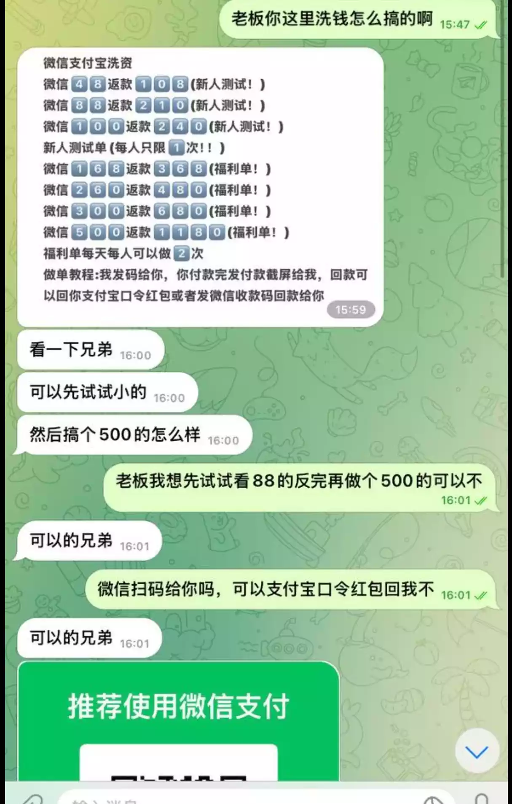
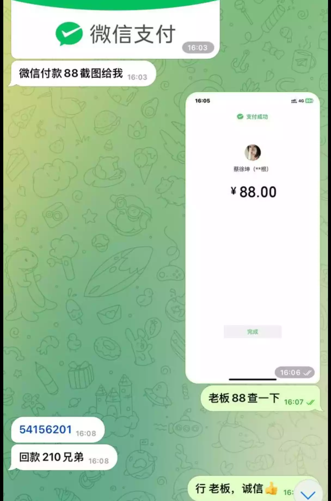
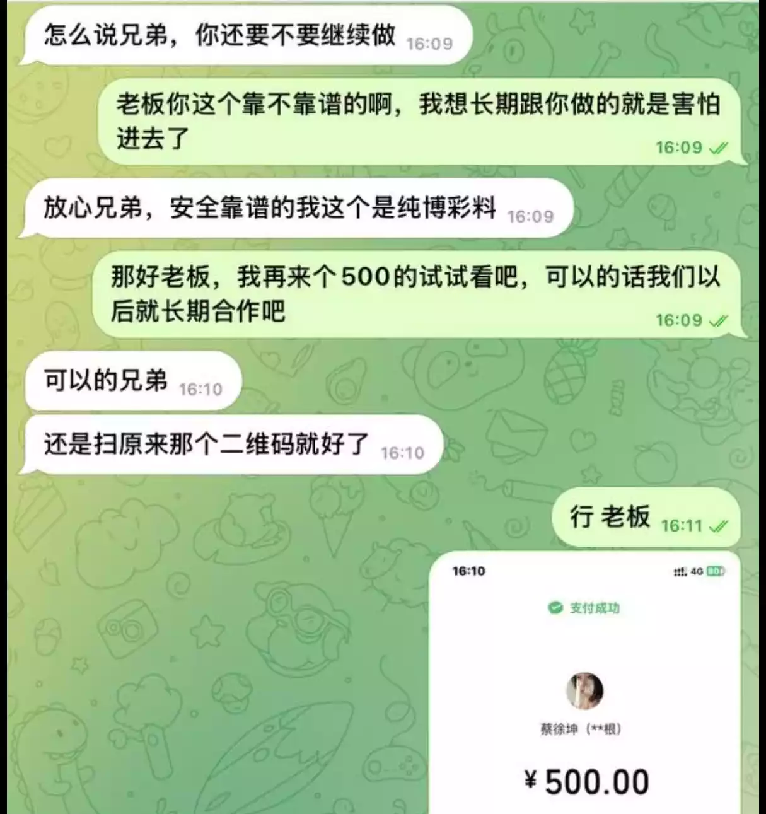
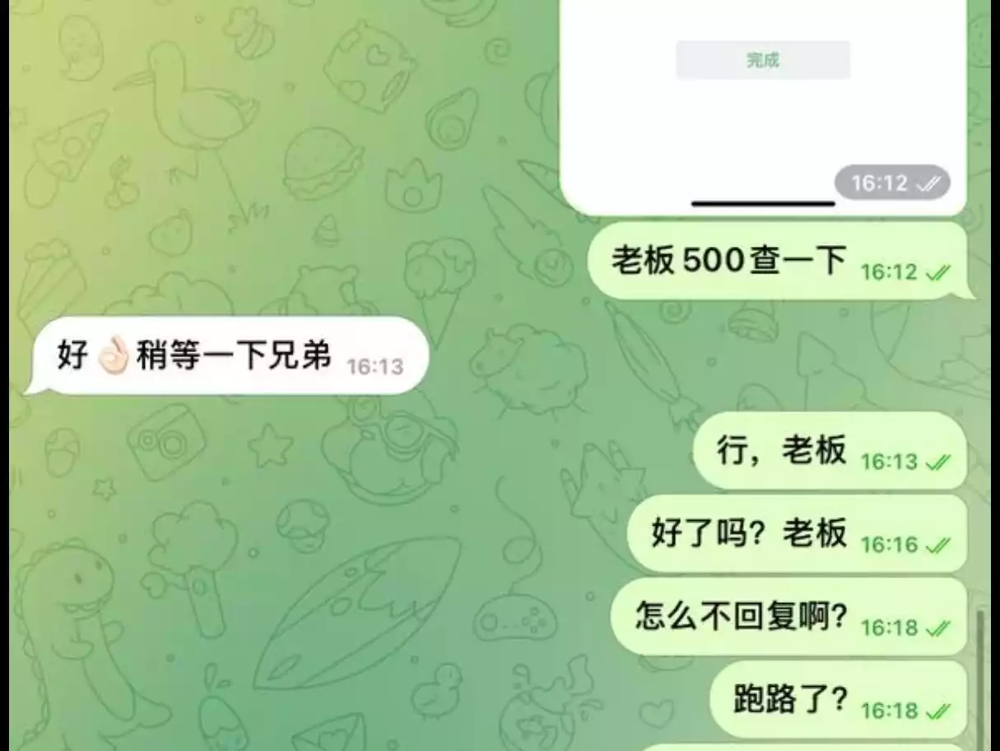
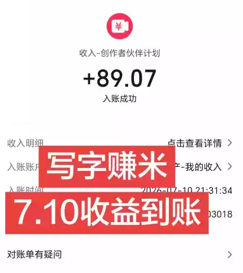
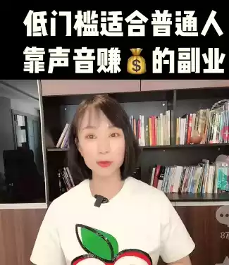
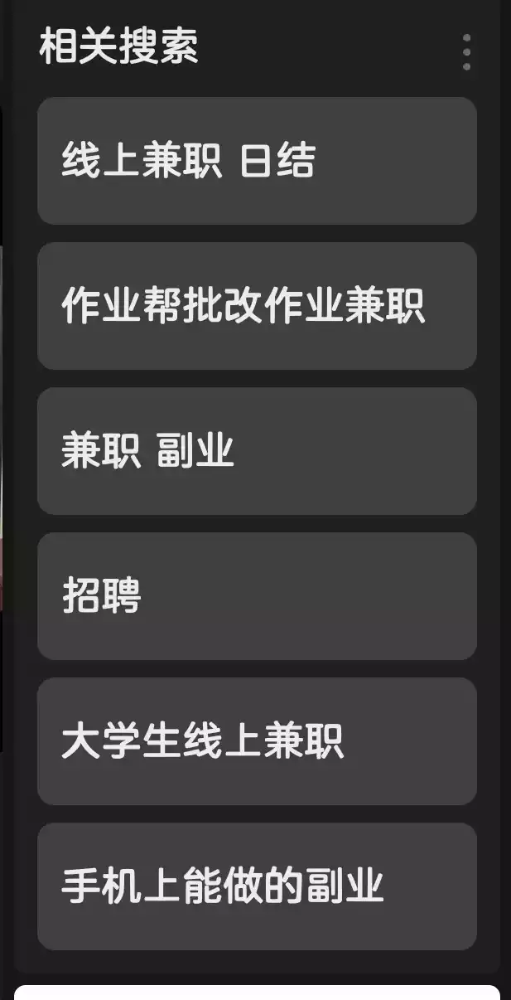
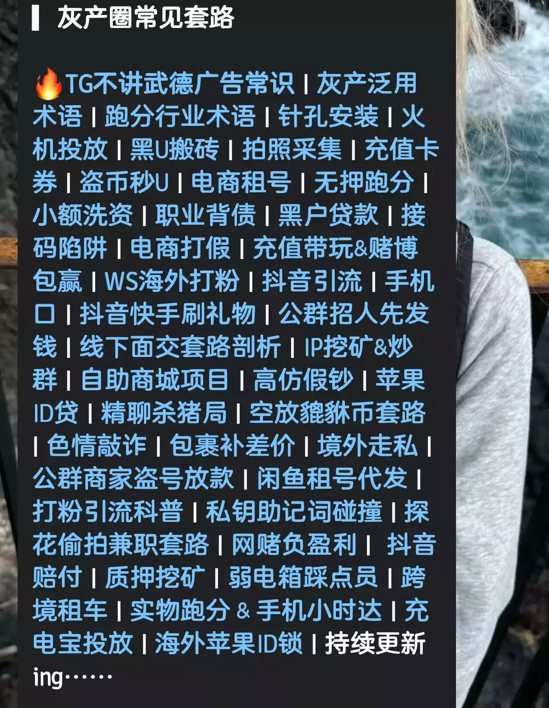

# 茗叙

今天想做一期诈骗案例合集，帮助更多人避免上当受骗。这些都是我自己收集的案例，其中部分素材来自我的亲身经历。为了获取更完整的诈骗步骤，我曾假意配合骗子完成任务，在虚拟机环境中操作，并提供虚假信息。为了收集素材，我甚至接到了国家反诈中心的电话，警察还亲自上门为我科普反诈知识。话不多说，直接进入主题。

# 茗述

## 洗钱案例

> 有些人认为++洗钱是游走在法律的边缘++，抱着试试的心态，觉得这属于<ins class="wavy">灰黑产业</ins>，应该没什么事。但正是这种想法，让人一步步落入骗子的陷阱。骗子先让你尝点甜头，以小钱返2-3倍的价格，初次会给你结账；但到后面你再次充值更多时，他们就不给你结账，把你拉黑跑路，你连申诉的地方都没有。我就有过这样的案例，<ins class="dot">本次案例为亲身经历，素材来自他人</ins>

> 首先总结一下，为什么是微信扫码、支付宝红包？
>
> 因为微信转账之后`无法退回`，支付宝支付可以`申诉退回`。很多人都有想<ins class="dot">“先试试小的，再试试大的”</ins>的心理，觉得小的都成功了，看来这个人可信；可当你给他转第二笔的时候，他怎么可能不跑路呢？

我的亲身案例

> 想法都是一样的，但对接我的骗子比较专业，他每笔都需要`两次转账`。例如上述48的方案，需要两笔48才行。首先也是给你发一个收款码，但48的第一笔收款码是假的，是别人的收款码（这个后面会提到）。之后他会给你一个二维码，<ins class="wavy">让你去抖音购买卡券核销（话费卡、礼品卡、油卡、购物卡），之后把账号和密码发给他</ins>，金额与卡内余额相等。
>
> 这相当于一种`虚拟货币`，拿到之后他会`直接转移走`。
>
> 两笔48到手之后，他才会给你打款，让你发自己的收款码。
>
> 之后提现需要再次购买两次98的卡，并且都需要在`5分钟内购买完成`；如果没有完成，就会让你再次补卡，意思就是再买两次卡。
>
> `注意：`每次给你发完二维码之后，他都会提醒你赶紧付款，每过一分钟就会发还有xx分钟。每付完一笔、把账号密码给他，他都会给你算：这是48×2=96，加上98×2=294，之后继续这样，给你一种随时都能提现的感觉，只要继续做，前面那些都会回本，于是你就会一股脑地做下去。这时你已经上头了，是否还能幡然醒悟、就此止步呢？

直到第二天，你发现微信收到了同样一笔48的转账（钩子在这里）

> 有人说，那我测试之后拿完第一次返款就走怎么样？
>
> 那你猜这个图片是谁放出来的？到底是真的被骗用户，还是什么人？第一次测试就要88，为什么不好好吃一顿呢？

## 兼职诈骗

> 有时候你会在**抖音、快手、小红书**刷到各种兼职赚钱的视频，例如：**哄睡、语聊、播音、作业帮批改作业、聊天**等小项目日结的兼职，让你去**关注公众号**，或者**加入QQ群**获取兼职。很好，恭喜你掉入了陷阱。这种风险不是很大，不会让你支付，但会消耗你的时间以及信用。

上面看到的所有兼职，最后都需要你去做一个任务，就是给别人**发送短信**，或者用**自己的账号**发送兼职信息，也就是帮他**引流**。这还算小事，顶多账号被封；但如果使用短信给别人发送链接信息，可能会导致手机号被限制发送短信。这些倒是还好，损失不是很大，但后面的案例就是另一个性质了。

> 当你的账号封禁或者手机号封禁的时候，你会转头就走吧，认为这是个教训。
>
> 但是封禁都是有延迟的，所以他会给你**结账**，让你继续做任务。接下来的任务就会涉及到`H(yellow)`，使用你的资源，例如**社交平台，添加多个人发送<ins class="dot">带有特殊意义的照片或者小程序</ins>**，根据步骤让其操作，会跳转到H软件的引流。这些目标用户都需要你去对接，当然你肯定不知道这是H软件，所以间接地把软件传给别人，已经触犯了传播淫秽物品罪，相当于小型的柬埔寨，难道不是吗？<ins class="wavy">你只是为了拿到一个人10r的提成，却不知不觉间坑害了所有人，等到你的账号被封禁，你的利用价值就没有了</ins>。

## 抖音引流，送礼物

这个被骗的案例太多了，会声称****免费提供软件脚本****，日入几千。其实诸如此类需要购买账号的项目都不可信。别总想着几十几百没人骗，无论对方说得再好听，说什么可以自己购买账号，但最终你都要找他们提供渠道；你自己买到的，他们都会找各种理由说不能用。

> `引流都是假的`，我亲历的案例为送礼物的案例。
>
> 这个案例倒是真的太变态了，会使用你的抖音账号给一些**小众生活的博主**刷礼物。我们都知道，刷礼物会有一个悬浮弹窗，什么情况下你会点进去呢？
>
> 答：当头像足够吸引你，例如美女的照片。
>
> 这个目标用户就是**长期xin压抑的男性用户**，一般在**30-60**之间。当他们顺着你的头像点进去之后，会在背景看到之前预设好的**二维码**，他肯定控制不住想要扫码，而二维码的内容就是`luo聊、H软件`。

> 那么我怎么做的？
>
> 答：头像没办法避免，于是我从二维码入手，自己编写了一个页面，扫码之后跳转到国家反诈APP的下载页面。这倒是非常有意思，最后被发现了，没有给我结账。
>
> 但然而，即使我之后将头像和背景换回去，也避免不了被封号，禁言了一个月，账号权重直线下滑；后面申诉之后，平台理解我的操作，于是给我缩短到了7天。

还有就是抖音发类似擦边的视频……这个你不封号谁封号？？

## 拍照骗局

什么让你去拍小摊店铺的收款码，让你去拍汽车违规停车，拍商业街的违规建筑。

> 我就问了，这些事情什么时候轮到你去惩恶扬善了？？
>
> ****小摊的收款码****：拍完之后，估计会给你两块钱。你是得到了这两块，但有没有想过他拿到之后去做什么？使用支付宝或者微信，把钱故意转给人家，之后让他退款到某个银行卡，转过去的钱基本上都是**风控**的。这样的案例你真的没有见过吗？<ins class="wavy">这会残害多少家庭，你的良心不会痛吗？</ins>通过现有的黑科技，可以解析微信收款码的链接，得到他的手机号；那么拿到手机号之后能干什么，我就不用多说了。

> **汽车违规停车拍照**
>
> 有人会看到有个拍车牌的项目，拍一个最低100块，最高1000块，日入5000+。而且可以肯定不是骗设备押金的，因为他们说可以自己去淘宝买设备。
>
> ✨这要是真的，能拍到他破产！这些骗子看骗设备越来越难，于是心生一计，进阶了套路。骗一个设备才多少钱？所以设备你可以去淘宝店买，但是整了设备之后，就给你发来一个软件，让你安装到设备里，并告诉你说这是一个伪装的APP，用来同步数据；作用就是一般人就算拿到设备也不知道是干啥的，主打的就是一个安全。
>
> ✨软件安装登录需要开通使用权限，且是按月付费：一个月150U，三个月300U，六个月只需400U……
>
> ✨到这不已经很明显了吗？但是你还是会尝试！为什么？设备都买来了，不试试怎么能甘心呢？试了后悔两年，不试后悔一辈子！
>
> ✨我自己肯定是不会去尝试，但我既然揭秘了基本都是骗子，有头铁的大可一试。钱要这么容易挣，骗子何必不辞辛劳日夜蹲守各大群里发广告招小白？
>
> **以上是我自己复制的**
>
> 按我自己来说，平常路上遇到问题，确实可以举报，但是不该管的是不是管得太多了呢？道路安全全靠你来实现吗？这个责任放在你身上是否太重了？基本上每家每户都有车，谁会愿意大早上起来看到自己被违规的消息？再说，上面的报价基本上都是假的，<ins class="wavy">人家交警抓一个扣1分、罚200，路上都有监控，还需要你来帮助监控？既然抓到了，那为什么要给你分这200呢？你说是吧！</ins>

## luo聊诈骗

> 相信聪明人应该都知道，你的对面说不定是个男生。这里不讲案例，讲原理。
>
> 首先，会在你手机上安装一个软件，获取你的电话本、联系人、手机相册等等信息。

> 其实获取电话本很快，但是手机相册——想一想，手机相册这么多照片，骗子的服务器顶多2G2H，存不下你这么多照片，所以都是即时预览。那么我们该如何捣毁骗子的网站呢？
>
> 使用抓包软件**黄鸟**，或者**HTTP抓包工具**都可以。之后会发现有个域名反复出现，这时候一般来说可以通过`https://xxx.com/admin.html`或者`https://xxx.com/admin`进入管理员页面，之后使用弱密码例如123456、admin123等来爆破，或者使用字典进行自动爆破，进入他的后台。骗子的系统大部分都是PHP，而且都是旧版本，执行**绕提权**就可以进入后台，或者拿到root，进行删除指令；再不济就对域名执行域名轰炸，连续访问、连续获取资源，达到断掉骗子服务器的效果。

注：以上不提供任何详细教程，因为这里只做科普以及预防。

该项目大概率会持续更新，看时间是否充裕，目前先更新5个案例，更多案例看下图。

